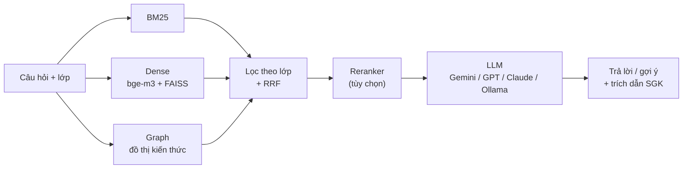

# ViMath Hybrid RAG

[](https://github.com/daitrong94/vimath-hybrid-rag/actions/workflows/ci.yml)
[](LICENSE)


**Hệ thống Hybrid RAG kết hợp đồ thị kiến thức chương trình Toán THCS (lớp 6–9): truy hồi định nghĩa, định lí, công thức và ví dụ từ sách giáo khoa để LLM giải thích và gợi ý có trích dẫn nguồn, không vượt quá chương trình của lớp học sinh.**

> **English summary.** A retrieval-augmented generation (RAG) module for a Vietnamese secondary-school (grades 6–9) math tutor. It retrieves definitions, theorems, formulas and worked examples from the official *Kết nối tri thức* textbooks with BM25, dense embeddings (bge-m3) and a curriculum knowledge graph, fuses them with Reciprocal Rank Fusion and an optional cross-encoder reranker, filters by the student's grade, and grounds LLM answers and hints in cited textbook passages. The project benchmarks Sparse vs. Dense vs. Graph vs. Hybrid retrieval on a hand-labelled golden set of 160 questions.

> 🚧 **Trạng thái:** khung dự án (skeleton). Các module có docstring và `TODO`; **chưa có kết quả thực nghiệm**. Tiến độ: [docs/ROADMAP.md](docs/ROADMAP.md).

## Động lực

Gia sư AI dùng LLM thuần dễ mắc ba lỗi với Toán THCS: **nhớ sai công thức**, **dùng kiến thức vượt lớp** và **diễn đạt khác SGK** (thuật ngữ, ký hiệu, dấu phẩy thập phân). Đề tài này là chủ đề #8 (Truy hồi thông tin & RAG) trong chương trình nghiên cứu Gia sư AI cho Toán THCS, môn Xử lý ngôn ngữ tự nhiên, Trường ĐH Khoa học Tự nhiên – ĐHQGHN. Module truy hồi lấy đúng nội dung SGK Toán 6–9 phù hợp với lớp của học sinh làm ngữ cảnh có trích dẫn cho LLM, và so sánh có hệ thống các phương pháp truy hồi Sparse / Dense / Graph / Hybrid.

Chi tiết: [docs/PROJECT_BRIEF.md](docs/PROJECT_BRIEF.md).

## Kiến trúc tổng quan



Phía offline: PDF SGK → OCR (Marker/MinerU) → chunk theo bài/mục kèm metadata → chỉ mục BM25/FAISS; đồ thị kiến thức xây từ Chương trình GDPT 2018 và mục lục SGK (LLM gợi ý, người hiệu đính). Chi tiết: [docs/ARCHITECTURE.md](docs/ARCHITECTURE.md).

## Bắt đầu nhanh

Yêu cầu: [uv](https://docs.astral.sh/uv/) và Python 3.12 (uv tự tải nếu máy chưa có).

```bash
# 1. Cài đặt
git clone https://github.com/daitrong94/vimath-hybrid-rag.git
cd vimath-hybrid-rag
uv sync                                                      # core + dev (không cần torch)
uv sync --extra ingest --extra ml --extra llm --extra demo   # môi trường đầy đủ trên laptop
cp .env.example .env                                         # điền API key
uv run pre-commit install                                    # hook chặn commit dữ liệu SGK

# 2. Dữ liệu: đặt 8 file PDF vào data/raw/ (tên file: docs/DATA.md, mục 1.1)

# 3. Xây dựng corpus
uv run python scripts/build_corpus.py --stage probe          # phân loại trang: text / lỗi font / scan
python scripts/build_corpus.py --stage convert               # OCR, chạy trên Colab T4 (xem bên dưới)
uv run python scripts/build_corpus.py --stage chunk

# 4. Chỉ mục và đồ thị kiến thức
uv run python scripts/build_index.py --retriever all
uv run python scripts/build_kg.py

# 5. Đánh giá
uv run python scripts/run_eval.py --methods bm25 dense graph hybrid hybrid_rerank --split test

# 6. Demo (chỉ chạy cục bộ)
uv run python app/gradio_app.py
```

OCR trên Google Colab (T4):

```bash
pip install -e ".[ingest,ocr-marker]"      # hoặc ".[ingest,ocr-mineru]"
python scripts/build_corpus.py --stage convert --backend marker
```

**Chạy được ngay bây giờ:** `uv run pytest`; `uv run python scripts/build_kg.py --validate data/kg/example_graph.json`; `uv run python scripts/run_eval.py --golden data/golden_set/examples.jsonl --split all` (kiểm tra định dạng golden set rồi dừng ở `TODO`). Các bước còn lại đang ở dạng `TODO` theo lộ trình.

### Python API

```python
from vimath_rag.api import answer

result = answer(
    "Định lí Pythagore phát biểu thế nào?", grade=8, method="hybrid_rerank", mode="answer"
)
print(result.answer)  # câu trả lời có đánh dấu nguồn [1], [2]…
print([s.citation for s in result.sources])  # ví dụ "SGK Toán 8, Tập 1, Bài …, tr. …"
result.model_dump()  # dict: answer, sources, retrieved_chunks, usage…
```

## Kết quả

> Chưa có kết quả. Bảng dưới đây sẽ được điền từ `results/tables/`; mỗi con số dẫn tới một `run_id`.

Tập test của golden set (128/160 câu), lọc theo lớp `grade ≤ g`:

| Phương pháp | Recall@5 | MRR@10 | nDCG@10 | Faithfulness | Trễ truy hồi p50 | Chi phí / 100 câu |
|---|---|---|---|---|---|---|
| LLM không truy hồi | — | — | — | TBD | — | TBD |
| BM25 | TBD | TBD | TBD | TBD | TBD | TBD |
| Dense (bge-m3) | TBD | TBD | TBD | TBD | TBD | TBD |
| Graph (KG) | TBD | TBD | TBD | TBD | TBD | TBD |
| Hybrid (RRF) | TBD | TBD | TBD | TBD | TBD | TBD |
| Hybrid + Rerank | TBD | TBD | TBD | TBD | TBD | TBD |

Định nghĩa độ đo, bảng phụ và ablation: [docs/EVALUATION.md](docs/EVALUATION.md).

## Cấu trúc thư mục

```
├── configs/              # YAML: corpus, retrievers, models, eval
├── data/
│   ├── raw/              # (git-ignored) PDF SGK
│   ├── processed/        # (git-ignored) Markdown, chunk, chỉ mục
│   ├── golden_set/       # câu hỏi + id chunk đúng (schema + 3 ví dụ tổng hợp)
│   └── kg/               # lược đồ + ví dụ đồ thị kiến thức
├── src/vimath_rag/
│   ├── ingest/           # PDF → Markdown → chunk
│   ├── retrievers/       # bm25, dense, graph, hybrid, reranker
│   ├── kg/               # lược đồ, trích xuất ứng viên, xây dựng đồ thị
│   ├── generation/       # prompt, LLM client
│   ├── eval/             # độ đo truy hồi/sinh, chi phí, độ trễ
│   ├── schemas.py        # hợp đồng dữ liệu (pydantic)
│   └── api.py            # answer(), retrieve()
├── scripts/              # build_corpus, build_index, build_kg, run_eval, export_schemas
├── app/gradio_app.py     # demo một lượt
├── notebooks/            # chỉ để khám phá
├── results/              # bảng/biểu đồ tổng hợp (runs/ git-ignored)
├── tests/
└── docs/                 # PROJECT_BRIEF, ARCHITECTURE, DATA, EVALUATION, ROADMAP, REPORT_OUTLINE
```

## Dữ liệu và bản quyền

Nội dung SGK *Kết nối tri thức với cuộc sống* thuộc bản quyền của nhà xuất bản và tác giả. Repo **không chứa và không phân phối** PDF, văn bản OCR hay đoạn trích SGK; người dùng tự lấy SGK từ nguồn chính thức và đặt vào `data/raw/`. Repo chỉ commit mã nguồn, cấu hình, câu hỏi tự viết kèm id chunk, cấu trúc đồ thị kiến thức và số liệu tổng hợp. Hook pre-commit và CI chặn việc commit nhầm dữ liệu SGK. Chi tiết: [docs/DATA.md, mục 2](docs/DATA.md#2-chính-sách-bản-quyền).

## Lộ trình

6 tuần, hạn nộp ≈ 03/01/2027; mốc kết quả tối thiểu (BM25 + Dense + đánh giá end-to-end) ngày 06/12/2026. Xem [docs/ROADMAP.md](docs/ROADMAP.md).

## Giấy phép

Mã nguồn phát hành theo giấy phép [MIT](LICENSE) © 2026 daitrong94. Giấy phép này không áp dụng cho nội dung SGK.
