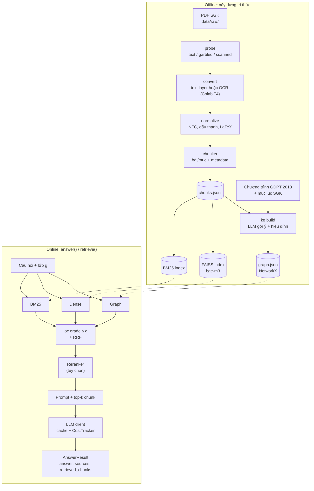

# Kiến trúc hệ thống

> Trạng thái: thiết kế (skeleton). Phần chưa triển khai được đánh dấu `TODO(Mx)` trong mã nguồn, với `Mx` là mốc trong [ROADMAP.md](ROADMAP.md).

## 1. Sơ đồ pipeline



Hai giai đoạn:

- **Offline (xây dựng tri thức):** PDF → Markdown → chunk → chỉ mục BM25 và FAISS; xây dựng đồ thị kiến thức chương trình.
- **Online (trả lời):** câu hỏi → các bộ truy hồi → lọc theo lớp → hợp nhất RRF → (rerank) → LLM → câu trả lời có trích dẫn.

## 2. Trách nhiệm các module

| Module | Trách nhiệm | Phụ thuộc chính |
|---|---|---|
| `config` | Đọc YAML trong `configs/`, nạp `.env` | PyYAML, python-dotenv |
| `schemas` | Hợp đồng dữ liệu (pydantic): `Chunk`, `GoldItem`, `RetrievedChunk`, `Source`, `Usage`, `AnswerResult`; đọc/ghi JSONL; quy ước `chunk_id` | pydantic |
| `ingest.probe` | Phân loại từng trang PDF: lớp văn bản tốt / lỗi font / scan | pypdfium2 |
| `ingest.convert` | PDF → Markdown + LaTeX (lớp văn bản, hoặc OCR qua CLI của Marker/MinerU), chèn mốc trang `<!-- page: N -->` | pypdfium2; Marker/MinerU (Colab) |
| `ingest.normalize` | Chuẩn hóa Unicode NFC, kiểu đặt dấu, biến thể i/y, LaTeX; bỏ header/footer | thư viện chuẩn |
| `ingest.chunker` | Tách Chương → Bài → mục → khối; gán loại, metadata và `chunk_id` | thư viện chuẩn |
| `retrievers.bm25` | BM25 trên âm tiết (hoặc từ ghép bằng underthesea) | bm25s |
| `retrievers.dense` | Embedding bge-m3 + FAISS (inner product trên vector chuẩn hóa) | sentence-transformers, faiss-cpu |
| `retrievers.graph` | Liên kết khái niệm → lan truyền trên đồ thị (PPR/BFS) → chunk | NetworkX |
| `retrievers.hybrid` | RRF nhiều bộ truy hồi + rerank tùy chọn | thư viện chuẩn |
| `retrievers.reranker` | Cross-encoder bge-reranker-v2-m3 | sentence-transformers |
| `kg.schema` | Nạp `data/kg/schema.yaml`; kiểm tra kiểu nút/cạnh, DAG tiên quyết, tính đơn điệu theo lớp | NetworkX, PyYAML |
| `kg.extract` | LLM gợi ý khái niệm/quan hệ ứng viên theo từng bài → CSV để hiệu đính | `generation.llm` |
| `kg.build` | CSV đã hiệu đính → đồ thị NetworkX → `data/kg/graph.json`; liên kết khái niệm ↔ chunk | NetworkX |
| `generation.prompts` | Prompt tiếng Việt cho chế độ trả lời / gợi ý / closed-book; định dạng ngữ cảnh và trích dẫn | thư viện chuẩn |
| `generation.llm` | Giao diện LLM chung (Gemini / OpenAI / Anthropic / Ollama), cache trên đĩa | SDK tương ứng (extra `llm`) |
| `eval.retrieval_metrics` | Hit@k, Recall@k, MRR@k, nDCG@k, Unit-Hit@k, Out-of-grade@k | thư viện chuẩn |
| `eval.generation_metrics` | Faithfulness, answer relevance, correctness (LLM-as-judge), độ chính xác trích dẫn | `generation.llm` |
| `eval.tracking` | Đo độ trễ, token, chi phí; dừng khi sắp vượt ngân sách | thư viện chuẩn |
| `api` | `retrieve(...)`, `answer(...)`: điểm vào công khai | các module trên |

## 3. Luồng dữ liệu và sản phẩm trung gian

| Sản phẩm | Đường dẫn | Tạo bởi | Dùng bởi | Commit? |
|---|---|---|---|---|
| PDF SGK | `data/raw/toan{6..9}_tap{1,2}.pdf` | người dùng tải | probe, convert | ❌ |
| Báo cáo probe | `data/processed/probe/{book_id}.json` | `build_corpus --stage probe` | convert | ❌ |
| Markdown + mốc trang | `data/processed/md/{book_id}.md`, `{book_id}.manifest.json` | `build_corpus --stage convert` | chunker | ❌ |
| Chunk | `data/processed/chunks/chunks.jsonl` (+ `chunks.meta.json`) | `build_corpus --stage chunk` | chỉ mục, KG, đánh giá, API | ❌ |
| Chỉ mục BM25 / FAISS | `data/processed/indexes/{bm25,dense}/` | `build_index` | retrievers | ❌ |
| Đồ thị kiến thức | `data/kg/graph.json` (nguồn: `data/kg/curated/*.csv`) | `build_kg` | graph retriever | ✅ chỉ cấu trúc |
| Golden set | `data/golden_set/golden_v1.jsonl` | gán nhãn thủ công | đánh giá | ✅ câu hỏi + id |
| Kết quả từng câu | `results/runs/{run_id}/` | `run_eval` | phân tích lỗi | ❌ chứa văn bản SGK |
| Bảng / biểu đồ tổng hợp | `results/tables/`, `results/plots/` | `run_eval` | README, báo cáo | ✅ |
| Cache LLM, sổ chi phí | `.cache/llm/`, `.cache/cost_ledger.jsonl` | `generation.llm`, `eval.tracking` | mọi lời gọi LLM | ❌ |

## 4. API công khai

```python
from vimath_rag.api import answer, retrieve

chunks = retrieve("Hằng đẳng thức bình phương của một tổng?", grade=8, method="hybrid", k=5)
result = answer("Định lí Pythagore phát biểu thế nào?", grade=8, method="hybrid_rerank")
result.answer  # str: câu trả lời có đánh dấu nguồn [1], [2], ...
result.sources  # list[Source]: ví dụ "SGK Toán 8, Tập 1, Bài ..., tr. ..."
result.retrieved_chunks  # list[RetrievedChunk]: chunk_id, score, rank, retriever, chunk
result.model_dump()  # dict cho các module khác của Gia sư AI
```

| Tham số | Kiểu | Mặc định | Ý nghĩa |
|---|---|---|---|
| `question` | `str` | | Câu hỏi tiếng Việt |
| `grade` | `int \| None` | `None` | Lớp của học sinh (6–9); `None` thì không lọc |
| `method` | `"none" \| "bm25" \| "dense" \| "graph" \| "hybrid" \| "hybrid_rerank"` | `"hybrid"` | Phương pháp truy hồi; `"none"` là LLM không truy hồi (baseline, chỉ dùng với `answer`) |
| `mode` | `"answer" \| "hint"` | `"answer"` | Giải thích đầy đủ, hoặc chỉ gợi ý (không lộ đáp số) |
| `k` | `int \| None` | theo config | Số chunk đưa vào ngữ cảnh |

Lược đồ đầy đủ: [`src/vimath_rag/schemas.py`](../src/vimath_rag/schemas.py). `AnswerResult` gồm `answer`, `sources`, `retrieved_chunks`, `method`, `mode`, `grade`, `usage` (token, chi phí, độ trễ từng bước).

## 5. Các bộ truy hồi

### 5.1 BM25 (sparse)

- Thư viện `bm25s`, biến thể Lucene, `k1 = 1.5`, `b = 0.75` (mặc định, chỉ tinh chỉnh trên dev).
- Token hóa: âm tiết (tách theo khoảng trắng và dấu câu), chữ thường, **giữ dấu thanh**; tên lệnh LaTeX thành token (`\frac` → `frac`); số thập phân như `3,5` giữ nguyên một token.
- Ablation: tách từ ghép bằng underthesea (A1); gộp biến thể i/y, chuẩn hóa kiểu dấu, viết công thức thành chữ (A2).

### 5.2 Dense

- `BAAI/bge-m3` qua sentence-transformers; vector chuẩn hóa L2; FAISS `IndexFlatIP` (tìm kiếm chính xác, vì corpus nhỏ; quy mô thực tế `TBD` sau khi chunk).
- bge-m3 không cần tiền tố chỉ dẫn (instruction) cho câu truy vấn.
- Truy vấn chạy trên CPU laptop; nếu encode toàn bộ corpus trên CPU quá chậm thì encode trên Colab rồi chép chỉ mục về.

### 5.3 Graph (đồ thị kiến thức chương trình)

1. **Liên kết khái niệm:** so khớp tên và bí danh khái niệm (sau chuẩn hóa) trong câu hỏi, ưu tiên cụm dài nhất; nếu không khớp, lấy top-m khái niệm gần nhất theo embedding của tên khái niệm.
2. **Nhận diện ý định tiên quyết:** các cụm như "trước khi", "cần biết", "cần ôn" → đi **ngược** theo cạnh `prerequisite_of`.
3. **Lan truyền:** Personalized PageRank khởi đầu từ các khái niệm đã liên kết, trọng số theo loại cạnh; hoặc BFS tối đa 2 bước (cấu hình). Ý tưởng dùng PPR trên đồ thị tham khảo HippoRAG (Gutiérrez et al., 2024).
4. **Khái niệm → chunk:** chunk được gắn khái niệm (`Chunk.concepts`) hoặc thuộc bài giới thiệu khái niệm (`appears_in_lesson`, `role = introduced`); nhân trọng số theo loại chunk (định nghĩa/định lí/công thức > ví dụ > giải thích > bài tập).
5. Lọc theo lớp, trả về top-k.

### 5.4 Hybrid (RRF) và rerank

- Mỗi bộ truy hồi thành phần trả về `candidate_k` (mặc định 50) ứng viên **đã lọc theo lớp**.
- Hợp nhất bằng RRF (Cormack et al., 2009): `score(d) = Σ_r w_r / (k + rank_r(d))`, `k = 60`, rank tính từ 1.
- `hybrid_rerank`: cross-encoder `BAAI/bge-reranker-v2-m3` xếp hạng lại top-N (mặc định 20) ứng viên sau RRF.
- RRF không cần dữ liệu huấn luyện nên hợp với golden set nhỏ; trọng số `w_r` chỉ tinh chỉnh trên dev.

### 5.5 Lọc theo lớp

- `le` (mặc định): giữ chunk có `grade ≤ g`, vì kiến thức lớp dưới vẫn hợp lệ.
- `eq`: chỉ lớp `g`; `none`: không lọc.
- Áp dụng giống nhau cho mọi phương pháp để so sánh công bằng; RQ3 so sánh bật/tắt bộ lọc.

## 6. Sinh câu trả lời

- Prompt tiếng Việt trong [`generation/prompts.py`](../src/vimath_rag/generation/prompts.py): chỉ dùng ngữ cảnh, không vượt chương trình lớp `g`, giữ ký hiệu SGK, công thức trong `$...$`, đánh dấu nguồn `[n]`, nói rõ khi ngữ cảnh không đủ.
- Chế độ `hint`: tối đa 3 gợi ý từ khái quát đến cụ thể, không đưa đáp số.
- Trích dẫn: `[n]` ánh xạ sang `Source.citation`, ví dụ `SGK Toán 8, Tập 1, Bài 12: <tên bài>, tr. 45`. Số trang in = trang PDF − `printed_page_offset` (khai báo cho từng tập trong `configs/corpus.yaml`).
- Backend LLM chọn trong `configs/models.yaml`: `dev` = Gemini Flash free tier, `final` và `judge` = `TBD`, `local` = Ollama qua endpoint tương thích OpenAI.
- Mọi lời gọi LLM đi qua `CachedLLMClient` (cache theo hash của prompt, model và tham số) và `CostTracker` (ghi token và chi phí vào sổ, dừng trước khi vượt giới hạn trong `configs/eval.yaml`).

## 7. Cấu hình

| File | Điều khiển |
|---|---|
| `configs/corpus.yaml` | Danh sách sách, ngưỡng probe, backend OCR, chuẩn hóa, quy tắc tách chunk, xây dựng KG |
| `configs/retrievers.yaml` | Tham số BM25 / dense / graph / hybrid / reranker, lọc theo lớp, định nghĩa các `method` |
| `configs/models.yaml` | Mô hình embedding, reranker, các LLM (`dev`, `final`, `judge`, `local`), bảng giá, cache |
| `configs/eval.yaml` | Golden set, split, phương pháp, k, độ đo, ngân sách, thống kê, thư mục kết quả |

## 8. Môi trường chạy

| Môi trường | Dùng cho | Cài đặt |
|---|---|---|
| Laptop (CPU, Windows) | probe, chunk, BM25, truy vấn dense, KG, đánh giá, demo | `uv sync --extra ingest --extra ml --extra llm --extra demo` |
| Google Colab (T4) | OCR (Marker/MinerU); encode corpus nếu cần; fine-tune embedding (tùy chọn) | `pip install -e ".[ingest,ocr-marker]"` hoặc `".[ingest,ocr-mineru]"` |
| GitHub Actions | ruff + pytest + kiểm tra không commit dữ liệu SGK | `uv sync --locked` (core + dev) |

Hai extra `ocr-*` xung đột phiên bản với extra `llm` (marker-pdf và mineru yêu cầu SDK OpenAI/Anthropic/Gemini cũ hơn), nên được khai báo `conflicts` trong `pyproject.toml` và cài trong môi trường riêng.

## 9. Quyết định thiết kế

| Quyết định | Lý do |
|---|---|
| OCR là một bước riêng, gọi qua CLI trên Colab | Cần GPU, phụ thuộc nặng, xung đột phiên bản với SDK LLM; giấy phép của công cụ và mô hình OCR cần kiểm tra riêng. Định dạng trung gian (Markdown + mốc trang) tách pipeline phía sau khỏi công cụ OCR. |
| `bm25s` thay vì `rank-bm25` | `bm25s` còn được duy trì, nhanh, lưu/nạp chỉ mục được (MIT); `rank-bm25` không có bản phát hành mới từ 2022. |
| FAISS `IndexFlatIP` | Corpus nhỏ: tìm kiếm chính xác, không có sai số ANN, không cần tinh chỉnh. |
| RRF thay vì học trọng số kết hợp | Không đủ dữ liệu huấn luyện; RRF ổn định, ít siêu tham số. |
| NetworkX trước, Neo4j tùy chọn | Đồ thị nhỏ, chạy trong bộ nhớ, không cần dịch vụ ngoài, dễ tái lập. |
| pydantic làm hợp đồng dữ liệu | Kiểm tra dữ liệu sớm; sinh JSON Schema cho các module khác. |
| LLM-as-judge tự viết, RAGAS chỉ để đối chiếu | Kiểm soát prompt tiếng Việt, số lời gọi và chi phí trong ngân sách 10 USD. |
| `chunk_id` theo vị trí cấu trúc, không theo hash văn bản | Ổn định khi chạy lại OCR, nên golden set tham chiếu được lâu dài. |
| Core không có torch | Test và CI chạy nhanh; phụ thuộc nặng nằm trong extras và được import trễ (lazy import). |
