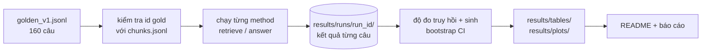

# Kế hoạch đánh giá

> Mọi con số trong tài liệu này là `TBD` cho đến khi được tạo ra bởi `scripts/run_eval.py`; mỗi số trong báo cáo phải dẫn tới một `run_id`.

## 1. Từ câu hỏi nghiên cứu đến thí nghiệm

| RQ | Thí nghiệm | Độ đo chính | Đầu ra |
|---|---|---|---|
| RQ1 | E1: BM25, Dense, Graph trên tập test | Recall@5, MRR@10, nDCG@10, tổng thể và theo `qtype` | Bảng 1, Bảng 2 |
| RQ2 | E2: Hybrid (RRF), Hybrid + Rerank so với phương pháp đơn tốt nhất | Như E1, thêm độ trễ p50/p95 | Bảng 1 |
| RQ3 | E3: mọi phương pháp, bật/tắt lọc theo lớp | Out-of-grade@5, Recall@5 | Bảng 4 |
| RQ4 | E4: sinh câu trả lời với `none` (closed-book), BM25, Dense, Hybrid + Rerank | Faithfulness, answer relevance, citation accuracy, correctness, token, chi phí | Bảng 3 |
| RQ5 *(tùy chọn)* | E5: Dense fine-tuned so với Dense gốc | Như E1 | Bảng 1 (thêm dòng) |

## 2. Thiết lập chung

- Corpus: `corpus_version` = `TBD`. Golden set `golden_v1`: 160 câu, 32 dev / 128 test (DATA.md, mục 5.2).
- Mọi tinh chỉnh (prompt, trọng số RRF, `k` của RRF, top-N rerank, ngưỡng) chỉ làm trên **dev**; kết quả chính báo cáo trên **test**.
- Lọc theo lớp `le` áp dụng cho mọi phương pháp (trừ thí nghiệm E3).
- Mỗi lần chạy ghi lại: commit hash, ảnh chụp cấu hình, phiên bản thư viện, phần cứng, seed (`42`), `PROMPT_VERSION`.

## 3. Độ đo truy hồi

Ký hiệu: `R_k` = top-k chunk trả về; `G` = `gold_chunk_ids`; `S` = `supporting_chunk_ids`; `rel(d)` = 2 nếu `d ∈ G`, 1 nếu `d ∈ S`, 0 nếu khác.

| Độ đo | Định nghĩa |
|---|---|
| Hit@k | 1 nếu có ít nhất một chunk gold trong `R_k`, ngược lại 0 |
| Recall@k | Số chunk gold có trong `R_k` chia cho số chunk gold |
| MRR@10 | 1 / hạng của chunk gold đầu tiên trong top-10 (0 nếu không có) |
| nDCG@10 | DCG@10 / IDCG@10, với relevance phân cấp `rel(d)` |
| Unit-Hit@k | 1 nếu có chunk trong `R_k` thuộc một bài gold (`unit_id`), tức đúng ở mức trích dẫn |
| Out-of-grade@k | Tỉ lệ chunk trong `R_k` có lớp > lớp của học sinh; đo **trước** khi lọc để thấy tác dụng của bộ lọc |

Công thức DCG: `DCG@k = Σ_{i=1..k} (2^rel_i − 1) / log2(i + 1)`. Các giá trị `k ∈ {1, 3, 5, 10}`. Mọi độ đo lấy trung bình trên các câu hỏi (macro).

## 4. Độ đo sinh

| Độ đo | Cách đo |
|---|---|
| Faithfulness | LLM-judge tách câu trả lời thành các mệnh đề và kiểm tra từng mệnh đề có được ngữ cảnh hỗ trợ không; điểm = số mệnh đề được hỗ trợ / tổng số mệnh đề |
| Answer relevance | LLM-judge chấm 1–5 mức độ trả lời đúng trọng tâm câu hỏi, chuẩn hóa về [0, 1] |
| Citation accuracy | Tỉ lệ trích dẫn `[n]` trỏ tới chunk thuộc bài gold |
| Correctness | LLM-judge so câu trả lời với `reference_answer` (câu `definition` và `formula` có đáp án) |
| Chất lượng gợi ý (đánh giá thủ công, nhỏ) | Khoảng 20 câu dev ở chế độ `hint`: không lộ đáp số, đúng kiến thức, hữu ích (thang 1–3) |

**Quy trình dùng judge:**

- Mô hình judge thuộc họ khác với mô hình sinh (`configs/models.yaml: llm.judge`), nhiệt độ 0, prompt tiếng Việt có rubric, kết quả được cache.
- **Hiệu chỉnh trước khi dùng:** tự chấm tay 30 câu trả lời trên dev và đo mức đồng thuận với judge (`TBD`) trước khi chạy trên test.
- RAGAS (tùy chọn) chỉ dùng để đối chiếu, không phải độ đo chính.

## 5. Hiệu năng và chi phí

- Độ trễ theo từng bước (từng bộ truy hồi, hợp nhất, rerank, LLM), báo cáo p50/p95, đo trên laptop CPU; ghi rõ cấu hình phần cứng.
- Token vào/ra và chi phí USD, tính theo bảng giá trong `configs/models.yaml` (chép từ trang giá của nhà cung cấp trước mỗi lần chạy trả phí).
- Thời gian xây chỉ mục và dung lượng chỉ mục.

## 6. Bảng kết quả (mẫu)

**Bảng 1. Kết quả chính (test, n = 128, lọc theo lớp `le`)**

| Phương pháp | Hit@1 | Recall@5 | Recall@10 | MRR@10 | nDCG@10 | Unit-Hit@5 | Faithfulness | Answer rel. | Trễ truy hồi p50 (ms) | Chi phí / 100 câu (USD) |
|---|---|---|---|---|---|---|---|---|---|---|
| LLM không truy hồi (closed-book) | — | — | — | — | — | — | TBD | TBD | — | TBD |
| BM25 | TBD | TBD | TBD | TBD | TBD | TBD | TBD | TBD | TBD | TBD |
| Dense (bge-m3) | TBD | TBD | TBD | TBD | TBD | TBD | TBD | TBD | TBD | TBD |
| Graph (KG) | TBD | TBD | TBD | TBD | TBD | TBD | TBD¹ | TBD¹ | TBD | TBD¹ |
| Hybrid (RRF: BM25 + Dense + Graph) | TBD | TBD | TBD | TBD | TBD | TBD | TBD¹ | TBD¹ | TBD | TBD¹ |
| Hybrid + Rerank | TBD | TBD | TBD | TBD | TBD | TBD | TBD | TBD | TBD | TBD |
| *(tùy chọn)* Dense fine-tuned | TBD | TBD | TBD | TBD | TBD | TBD | — | — | TBD | — |

¹ Đánh giá sinh mặc định chỉ chạy cho `none`, BM25, Dense, Hybrid + Rerank (`configs/eval.yaml: generation.methods`); các ô này chỉ điền nếu còn ngân sách, ngược lại ghi "—".

**Bảng 2. Recall@5 theo loại câu hỏi (test, 32 câu mỗi loại)**

| Phương pháp | definition | formula | prerequisite | applied |
|---|---|---|---|---|
| BM25 | TBD | TBD | TBD | TBD |
| Dense | TBD | TBD | TBD | TBD |
| Graph | TBD | TBD | TBD | TBD |
| Hybrid | TBD | TBD | TBD | TBD |
| Hybrid + Rerank | TBD | TBD | TBD | TBD |

**Bảng 3. Sinh câu trả lời (test)**

| Phương pháp | Faithfulness | Answer rel. | Citation acc. | Correctness | Token vào / ra (TB) | Trễ LLM p50 (ms) | Tổng chi phí (USD) |
|---|---|---|---|---|---|---|---|
| LLM không truy hồi | TBD | TBD | — | TBD | TBD | TBD | TBD |
| BM25 | TBD | TBD | TBD | TBD | TBD | TBD | TBD |
| Dense | TBD | TBD | TBD | TBD | TBD | TBD | TBD |
| Hybrid + Rerank | TBD | TBD | TBD | TBD | TBD | TBD | TBD |

**Bảng 4. Lọc theo lớp (test)**

| Phương pháp | Out-of-grade@5 (không lọc) | Recall@5 (không lọc) | Recall@5 (lọc `le`) |
|---|---|---|---|
| BM25 | TBD | TBD | TBD |
| Dense | TBD | TBD | TBD |
| Graph | TBD | TBD | TBD |
| Hybrid + Rerank | TBD | TBD | TBD |

## 7. Ablation (trên dev, trừ khi ghi khác)

| Mã | Thay đổi | Câu hỏi |
|---|---|---|
| A1 | Token hóa BM25: âm tiết vs. từ ghép (underthesea) | Tách từ có giúp BM25 tiếng Việt không? |
| A2 | Chuẩn hóa khóa tìm kiếm: gộp i/y, kiểu dấu; viết công thức thành chữ ("căn bậc hai") | Chuẩn hóa toán học có giúp truy hồi từ vựng không? |
| A3 | Hybrid không có Graph (`hybrid_no_graph`) | Đồ thị đóng góp bao nhiêu? |
| A4 | `k` của RRF ∈ {10, 30, 60, 100}; trọng số thành phần | Hợp nhất nhạy đến đâu với tham số? |
| A5 | Rerank top-N ∈ {10, 20, 50} | Đánh đổi chất lượng và độ trễ |
| A6 | Graph: PPR vs. BFS; bỏ từng loại cạnh | Phần nào của KG hữu ích? |
| A7 | Đánh chỉ mục có/không có chunk `exercise` | Bài tập có gây nhiễu không? |
| A8 | Câu hỏi không dấu (bỏ dấu tự động từ tập test) | Độ bền với cách gõ của học sinh |
| A9 | Số chunk ngữ cảnh k ∈ {3, 5, 8} khi sinh | Đánh đổi faithfulness và chi phí |

## 8. Kiểm định thống kê

- So sánh từng cặp phương pháp trên cùng các câu hỏi bằng **paired bootstrap** (10 000 lần lấy mẫu lại), báo cáo hiệu số kèm khoảng tin cậy 95%, không chỉ một con số.
- Khi so sánh nhiều cặp: hiệu chỉnh Holm (tùy chọn).
- n = 128 khá nhỏ; kết luận theo từng loại câu hỏi (32 câu mỗi loại) chỉ mang tính gợi ý.

## 9. Phân tích lỗi

Với mỗi phương pháp chính, lấy tối đa 20 câu có Recall@5 = 0 và gán nguyên nhân:

| Mã | Nguyên nhân |
|---|---|
| E-OCR | Lỗi OCR/LaTeX trong chunk gold |
| E-CHUNK | Ranh giới chunk sai (gold bị cắt hoặc bị gộp) |
| E-LEX | Lệch từ vựng/ký hiệu: từ đồng nghĩa, ký hiệu viết bằng chữ, biến thể chính tả |
| E-GRADE | Nhầm lớp: nội dung tương tự ở lớp khác |
| E-LINK | Graph: liên kết khái niệm sai hoặc thiếu |
| E-KG | Graph: thiếu hoặc sai cạnh trong KG |
| E-AMBIG | Câu hỏi mơ hồ, hoặc nhãn gold chưa đủ |
| E-GEN | Truy hồi đúng nhưng sinh sai (không trung thực, trích dẫn sai) |

Kết quả: bảng tần suất nguyên nhân × phương pháp, kèm 3–5 ví dụ minh họa (diễn giải lại, không chép dài văn bản SGK).

## 10. Ngân sách

- **Ước tính trước mỗi lần chạy trả phí:** chi phí ≈ số câu × số phương pháp × (token vào × giá vào + token ra × giá ra) + chi phí judge. Số token trung bình lấy từ các lần chạy dev (Gemini free tier).
- **Giới hạn cứng:** `budget.max_usd_total = 10` và `budget.max_usd_per_run = 3` (`configs/eval.yaml`); `CostTracker` dừng trước khi vượt, sổ chi phí nằm ở `.cache/cost_ledger.jsonl`.
- **Nếu ước tính vượt ngân sách:** thu hẹp tập phương pháp đánh giá sinh, giảm số chunk ngữ cảnh, hoặc chọn mô hình rẻ hơn. Mô hình `final` và `judge` được chọn ở tuần 4 dựa trên số token đo được.

## 11. Tái lập

- `run_eval.py` tạo `results/runs/{run_id}/` gồm `config_snapshot.yaml`, `env.json` (phiên bản thư viện, phần cứng, commit), kết quả từng câu (không commit) và `metrics.json`; đồng thời ghi bảng tổng hợp vào `results/tables/{run_id}_*.md|csv` (commit).
- Mỗi số trong README và báo cáo phải dẫn tới một `run_id`.
